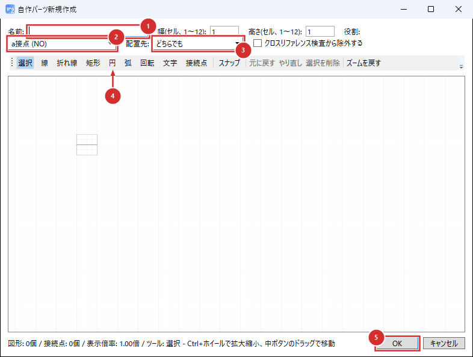

# 部品選択・自作パーツ管理

要素を配置する際に使う部品選択パネルと、自作パーツの追加方法を説明します。

## 部品選択パネル

ツールバーの「自作パーツ」ボタン（F11）を押すと、右側のパネルが部品選択リストに切り替わります。あらかじめ用意された部品（a接点・b接点・コイル・端子台・セレクトスイッチ・押釦・ランプ・モーター・タイマ接点・サーマルリレー・非常停止ボタンなど）と、自分で追加した自作パーツが、区別なく同じ一覧に表示されます。

一覧の各項目にはサムネイル画像・カテゴリ名・部品名が表示されます。クリックするとキャンバス上に配置できます（配置操作の項目を参照）。

## 自作パーツを作る

「パーツ」メニューの「新規作成...」で、自作パーツのエディタが開きます。図面の編集ができる状態でのみ選べます。



1. **名前**: パーツの名前を入力します。
2. **役割**: パーツの種類（a接点、コイルなど）を選びます。
3. **配置先**: 配置できる回路の種類を選びます。
4. **図形ツール**: 線・折れ線・矩形・円・弧・文字・接続点で記号の形を描きます。「選択」で描いた図形を動かしたり、「選択を削除」で消したりできます。
5. **OK**: 保存すると、部品選択パネルの一覧に加わります。

幅・高さ（セル単位、1〜12）でパーツの大きさを決めます。Ctrl+ホイールで拡大縮小、中ボタンのドラッグで表示位置を動かせます。

作ったパーツは `.gcadpart` ファイルとして自作パーツの保存フォルダに保存されます。ファイルを直接以下のフォルダへ置いても使えます。

```
マイドキュメント\Ecad2\図形\自作\
```

作ったパーツの編集と削除は、「パーツ」メニューの「自作パーツ」から行えます。

直接置いたファイルは、次回パネルを開いたときに自動的に一覧へ反映されます。

同じ部品ファイルをコピーするなどしてID（内部識別子）が重複した場合は、アプリが自動的に別のIDへ割り当て直すため、通常は問題になりません。

## 現時点でできないこと

- 部品のピン留め（お気に入り登録）
